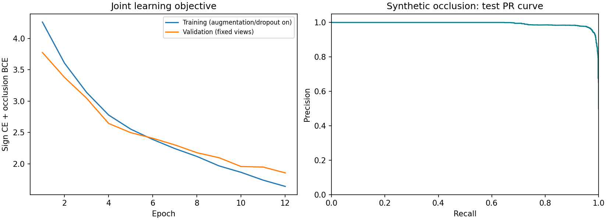
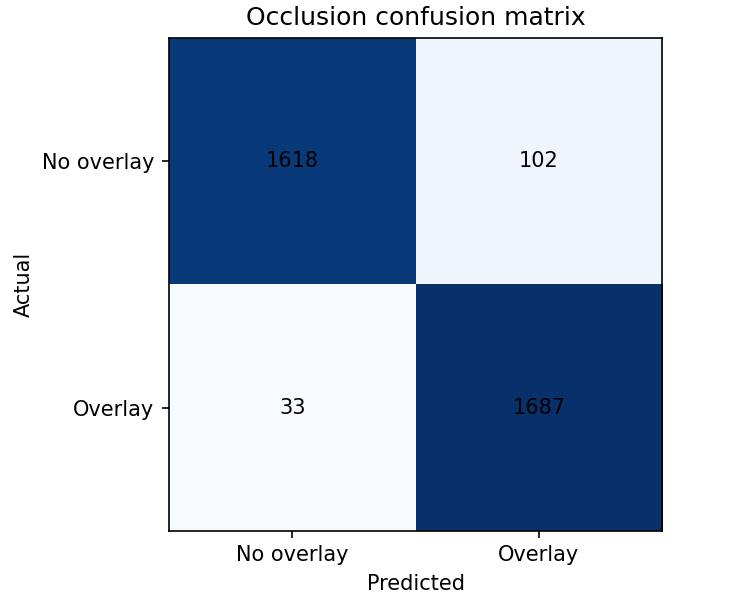
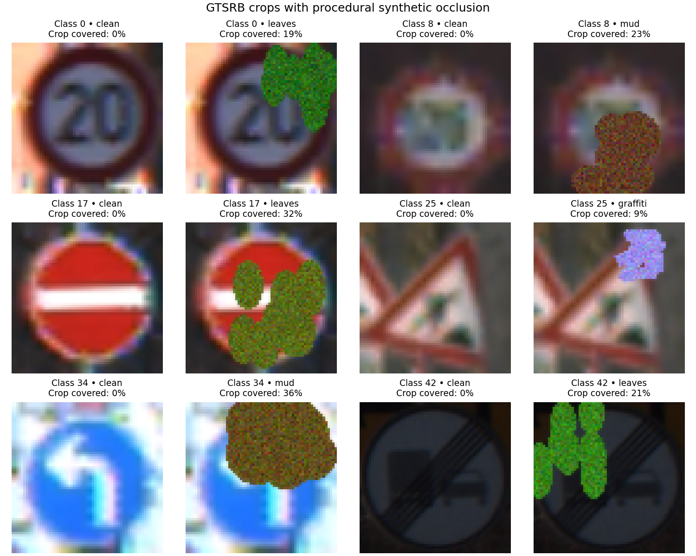

# Road Sign Occlusion — Experiment Report

Run status: **SUBSET DEMONSTRATION**.

Original-image split sizes: {'train': 4300, 'validation': 1290, 'test': 1720}. Each validation/test image has one clean and one occluded view. Paired views are correlated, not independent source images.

## Method

Custom three-block convolutional backbone (16/32/64 channels), pooled shared 128-dimensional representation, 43-class sign head and binary occlusion head. Training uses equal-weight cross-entropy and binary cross-entropy losses, AdamW, dropout 0.25, and early stopping on joint validation loss.

Training/validation are separated by class + physical sign track before augmenting. Test images come from the official final test split. All models see 64×64 crops using annotated sign ROIs. No horizontal flips are used.

Leaves, mud and graffiti are procedural textured approximations with randomized shapes, colors and positions. They are not photorealistic assets. Coverage measures the affected fraction of the crop, not a segmented sign surface.

## Held-out results

- Occlusion precision: 0.9430

- Occlusion recall: 0.9808

- Occlusion F1: 0.9615

- Occlusion average precision: 0.9927

- Sign accuracy on clean crops: 0.5407

- Sign accuracy on occluded crops: 0.3523

- Validation-selected threshold: 0.72

The threshold maximizes validation F1 over a predefined grid. The test set is not used to select it. A recall-oriented application would need a separately specified operating requirement and validation threshold rule.

## Interpretation and limitations

The subset/full run recorded clean sign accuracy 54.1% versus 35.2% with overlays. The difference shows recognition degradation under occlusion. Strong overlay-detection scores do not imply strong sign recognition.

Precision measures how often an occlusion flag is correct; recall measures how many synthetic occlusions are found. False negatives are missed overlays. Sign accuracy on occluded images tests whether the classifier still recognizes a partially covered sign.

These metrics concern added synthetic overlays. Original GTSRB images are not annotated here for natural occlusion, so “clean” means no added overlay, not verified unobstructed. A model may learn generator artifacts instead of general physical occlusion. Unseen occluder types, natural occlusions, weather, and full road scenes require independent evaluation.

This is sign-crop classification, not bounding-box detection in a full scene. The model does not localize signs. Its scores are uncalibrated and must not be interpreted as reliable uncertainty or used to control a vehicle. A road-scene pipeline would need a separate sign detector and real-world validation.

Subset runs demonstrate execution only. Low sign accuracy should be reported honestly; use the documented full-data training command to investigate improvements. Results from one seed do not establish robustness.

## Visuals

## Sources

https://benchmark.ini.rub.de/

https://sid.erda.dk/public/archives/daaeac0d7ce1152aea9b61d9f1e19370/published-archive.html